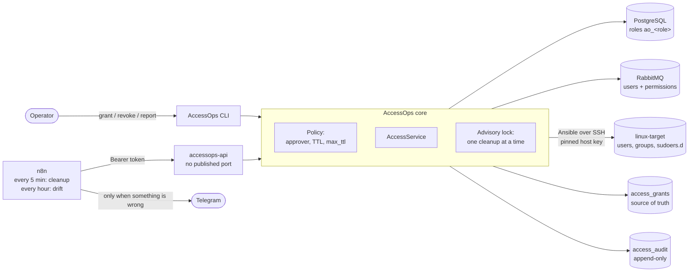

# AccessOps

[](https://github.com/daria-sobko-dev/accessops/actions/workflows/ci.yml)

Grant, audit and revoke access to **PostgreSQL, RabbitMQ and Linux servers** from one
role catalog, with an append-only audit log, temporary access that expires by itself
and alerts when reality drifts from what was approved.

## The problem

In a small team, access is usually granted by hand: a `CREATE ROLE` here, a RabbitMQ user
there, a Linux account with `sudo` "just for today". A few months later nobody knows
who has what, why, who approved it, or whether that temporary `sudo` was ever taken back.

AccessOps makes access boring and traceable:

- **Access as code.** Roles are defined once in [`roles.yaml`](roles.yaml) (validated by a
  Pydantic schema) and applied the same way to every system.
- **One command per change.** `grant` and `revoke` work across Postgres, RabbitMQ and Linux
  together, are idempotent, and support `--dry-run`.
- **Every attempt is audited**, including denied and failed ones, in a table that cannot
  be edited or deleted.
- **Temporary by default where it matters.** Privileged roles need a human approver and
  expire within 24h; a scheduled cleanup revokes expired access in every system.
- **Drift detection.** A report (and an hourly alert) shows accounts that exist without
  a grant, grants whose account is missing, and wrong roles.

## Architecture



All services run in Docker Compose. Ports of Postgres, RabbitMQ, n8n and linux-target
are bound to `127.0.0.1`; `accessops-api` has no published port at all and is reachable
only from inside the compose network.

## Quick start

Requirements: Docker with Compose, Python 3.12, `ssh-keygen`.

```bash
git clone https://github.com/daria-sobko-dev/accessops.git
cd accessops

python3.12 -m venv .venv
source .venv/bin/activate
pip install -r <(python .github/scripts/requirements.py)

# 1. Settings: copy the template and fill in your own values.
#    Generate passwords, e.g.: python -c "import secrets; print(secrets.token_urlsafe(24))"
cp .env.example .env
chmod 600 .env

# 2. Keys and tokens (written to .env and .credentials/, never printed).
python -m accessops ssh-bootstrap   # Ansible service key for linux-target
python -m accessops api-bootstrap   # token for accessops-api + key as a compose secret

# 3. Start everything and create databases, roles, vhost and tables.
docker compose up -d --build
python -m accessops init
```

Optional: Telegram alerts through n8n.

```bash
# Put TELEGRAM_BOT_TOKEN into .env, write any message to your bot, then:
python -m accessops telegram-setup  # finds your chat id, saves it to .env
python -m accessops n8n-setup       # credentials + workflows into n8n, schedules start
```

The n8n editor is at http://localhost:5678 (create the owner account on first visit).

## CLI

```text
python -m accessops grant <user> <role> [--ttl 30m|8h|3d] [--approved-by NAME] [--ticket ID] [--system postgres|rabbitmq|linux|all] [--dry-run]
python -m accessops revoke <user> [--ticket ID] [--dry-run]
python -m accessops list
python -m accessops cleanup [--dry-run]
python -m accessops report access|expiring|privileged|drift [--within 24h] [--csv path]
python -m accessops audit [--limit N]
```

Exit codes: `0` ok, `1` error, `2` denied by policy, `3` busy (another cleanup is running).
Times are stored in UTC and shown in `Europe/Madrid`.

### Grant temporary access (dry run)

```console
$ python -m accessops grant anna developer --ttl 8h --ticket ACC-42 --dry-run
DRY RUN: nothing was changed.
[postgres] grant anna role=developer: would change
  - create login role anna with a random password
  - mark anna as managed by AccessOps
  - grant ao_developer to anna
[rabbitmq] grant anna role=developer: would change
  - create user anna with a random password, tag accessops-role-developer
  - set permissions on vhost app: configure='', write='.*', read='.*'
[linux] grant anna role=developer: would change
  - would: generate SSH key anna-linux_ed25519
  - would: Create user with role groups
  - would: Ensure ~/.ssh exists (0700)
  - would: Install the SSH public key as the only authorized key (0600)
  - ansible: ok=10 changed=3 unreachable=0 failures=0 skipped=3
Access expires at 2026-10-14 02:40 CEST (in 7h 59m).
```

Without `--dry-run`, passwords and SSH keys of the new user are written to
`.credentials/<user>-<system>.txt` (mode 600) and never printed.

### Privileged roles are guarded

```console
$ python -m accessops grant boris devops_admin --ticket ACC-43
DENIED: Role 'devops_admin' is privileged and requires --approved-by (a human approver).

$ python -m accessops grant boris devops_admin --ttl 48h --approved-by olga
DENIED: Role 'devops_admin' is privileged: --ttl 2d is longer than the 24h limit.
```

Denied attempts are written to the audit log too.

### Cleanup of expired access

```console
$ python -m accessops cleanup
[linux] carl role=qa expired 2026-10-13 18:10 CEST: revoked
[postgres] carl role=qa expired 2026-10-13 18:10 CEST: revoked
[rabbitmq] carl role=qa expired 2026-10-13 18:10 CEST: revoked
```

In normal operation nobody runs this by hand: n8n calls it every 5 minutes.

### Drift report

```console
$ python -m accessops report drift
Drift: access_grants vs real systems

CATEGORY  SYSTEM    SUBJECT    EXPECTED_ROLE  ACTUAL_ROLE  MEANING
foreign   linux     ansible                                not created by AccessOps: shown only, never touched
foreign   linux     ubuntu                                 not created by AccessOps: shown only, never touched
foreign   postgres  accessops                              not created by AccessOps: shown only, never touched
foreign   rabbitmq  accessops                              not created by AccessOps: shown only, never touched

4 row(s)
```

| Category | Meaning |
|---|---|
| `extra` | account marked as managed by AccessOps, but no active grant |
| `missing` | active grant, but the account does not exist |
| `role_mismatch` | the account has a different role than the grant |
| `foreign` | account not created by AccessOps: reported, never changed |

Any report can be saved for spreadsheets with `--csv reports/access.csv`.

## Roles

| Role | Privileged | Postgres (schema `app`) | RabbitMQ (vhost `app`) | Linux | Max TTL |
|---|---|---|---|---|---|
| `developer` | no | SELECT, INSERT, UPDATE, DELETE | write, read | `developers` | - |
| `analyst` | no | SELECT | read | `analysts` | - |
| `qa` | no | SELECT, INSERT, UPDATE | write, read | `qa` | 7d |
| `devops_admin` | **yes** | all table privileges + CREATE | configure, write, read | `devops`, `developers`, sudo | 12h |

## Security decisions

- **Append-only audit.** `access_audit` has triggers that reject `UPDATE`, `DELETE` and
  `TRUNCATE`. Every grant and revoke attempt is recorded: success, denied or error,
  with actor, approver, ticket and details.
- **Privileged roles.** Admin-level rights (Postgres `TRUNCATE`/`CREATE`, RabbitMQ
  `configure`, Linux `sudo` or groups like `sudo`/`docker`) are only allowed in roles marked
  `privileged: true`; the catalog fails to load otherwise. Granting such a role needs
  `--approved-by` with a human approver who is not the actor (an AI or automation can never
  approve) and a `--ttl` of at most 24h.
- **TTL and cleanup.** `--ttl` sets `expires_at` in `access_grants`; roles can set a
  stricter `max_ttl`. Cleanup revokes expired grants system by system: if one system fails,
  the others are still processed, the error is audited and the grant stays active so the
  next run retries. Cleanup acts as `system:cleanup` in the audit log.
- **Drift.** `access_grants` is the source of truth; drift compares it with what really
  exists in each system. AccessOps marks its own accounts (Postgres comment, RabbitMQ tag,
  Linux GECOS field) and never touches accounts it did not create.
- **Advisory lock.** Cleanup takes a Postgres advisory lock (`pg_try_advisory_lock`), so
  the CLI and n8n can never run two cleanups at once; the second one returns "busy"
  (HTTP 409 / exit code 3). If a process dies, Postgres releases the lock with the connection.
- **Closed ports.** Every published port is bound to `127.0.0.1`. `accessops-api` has no
  published port; n8n reaches it by container name, and every endpoint except `/health`
  requires a Bearer token compared in constant time.
- **Docker secrets.** The Ansible private key reaches `accessops-api` as a compose secret
  (a file readable only by the API user), decoded into a memory-only `tmpfs`. It is not in
  the image and not in the container's environment. A whitelist `.dockerignore` keeps
  `.env` and `.credentials/` out of the build context.
- **Pinned host keys.** Ansible uses its own `known_hosts`. On the host, the key of
  linux-target is trusted on first use and rejected if it ever changes; inside
  `accessops-api` it is pinned from linux-target's public host key (only the `.pub` file
  is mounted, read-only). linux-target allows key-only SSH, no root login.
- **Secrets in n8n credentials.** The API token and the bot token live only in n8n's
  encrypted credential store. The workflow file in git refers to them by id and holds a
  placeholder instead of the chat id; `n8n-export` refuses to write a file that contains
  the value of any secret from `.env`.
- **Validated input.** User names, roles, durations, the role catalog and responses of
  external APIs (Telegram) are validated before use; SQL identifiers are always quoted
  through `psycopg.sql`.
- **No secrets in git.** `.env`, `.credentials/` and `reports/` are git-ignored; gitleaks
  runs before every commit (pre-commit) and on every push (CI), over the whole history.

## Testing

| Suite | Tests | Needs | Command |
|---|---|---|---|
| Unit | 170 | nothing (fakes for systems, clock and lock) | `pytest` |
| Integration | 17 | running `docker compose` stack | `pytest -m integration` |

```bash
ruff check . && ruff format --check .   # lint and formatting
pytest                                  # unit tests, under a second
pytest -m integration                   # real Postgres, RabbitMQ, linux-target
pre-commit install                      # ruff + gitleaks before every commit
```

Time is injected through `accessops/clock.py`, so tests like "access is revoked 31 minutes
later" run instantly. CI ([`.github/workflows/ci.yml`](.github/workflows/ci.yml)) runs
ruff and unit tests, a gitleaks scan of the whole history, and the integration tests
against a fresh compose stack with random throwaway secrets generated in the job.

## Project layout

```text
accessops/            Python package: CLI, service, policy, backends, API, reports
accessops/sql/        audit, grants and test database schemas
ansible/              playbook for Linux users, groups and sudoers.d
docker/               images for linux-target and accessops-api
n8n/workflows/        n8n workflows (no secrets; chat id placeholder)
roles.yaml            role catalog
tests/                unit tests; tests/integration needs Docker
```
